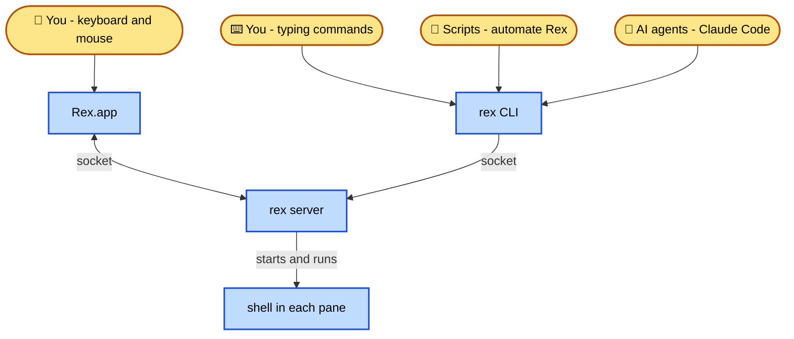

## Setup

- `mkdir -p ~/.config/rex && ln -s ~/.z/rex/init.lua ~/.config/rex/init.lua` - link the config
- `ctrl + space` `r` - reload the config
- `cmd + ,` - open Settings, set font to `JetBrainsMono Nerd Font Mono` size `16`
## Tabs

- `ctrl + space` `c` - create a new tab

- `ctrl + space` `1...9` - jump to the tab by number

## Panes

- `ctrl + space` `|` - create new pane vertically
- `ctrl + space` `\` - create new pane vertically
- `ctrl + space` `_` - create new pane horizontally
- `ctrl + space` `-` - create new pane horizontally
- `ctrl + space` `x` - close the current pane (closes the tab if it is the last pane)

- `ctrl + space` `l` - select pane to the right
- `ctrl + space` `h` - select pane to the left
- `ctrl + space` `k` - select pane to the above
- `ctrl + space` `j` - select pane to the down
- `alt + h/j/k/l` - select pane without the prefix

- `ctrl + space` `ctrl + h/j/k/l` - resize pane by 15
- `ctrl + space` `ctrl + r` - enter repeat mode, then `ctrl + h/j/k/l` to keep resizing, `enter` or `esc` to leave

## Other

- `ctrl + space` `ctrl + space` - send `ctrl + space` to the program

## Processes

Yellow rounded boxes are consumers, blue square boxes are processes.

| Consumer | Uses | Example |
|---|---|---|
| You | `Rex.app` | Typing in panes, `ctrl + space` keys, Settings |
| You | `rex` CLI | `rex config reload`, `rex keymap` |
| Scripts | `rex` CLI | Open a session with editor, server and test panes |
| AI agents | `rex` CLI | Claude Code reloading config, running a build in a new pane (see the `rex` skill) |

| Process | What it does |
|---|---|
| `Rex.app` | The window you see. Draws the terminal, takes your keystrokes, sends them to the server. |
| `rex server` | Runs in the background. Owns sessions, tabs and panes, reads `init.lua`. Keeps running after the app quits, like tmux. |
| shell in each pane | Your `zsh` (or any program) in a pane. Started by the server, so it survives the app closing. |
| `rex` CLI | Short-lived command, e.g. `rex config reload`. Asks the server to do something, then exits. |

## References
- https://www.superlogical.com/rex/docs/llms.txt
